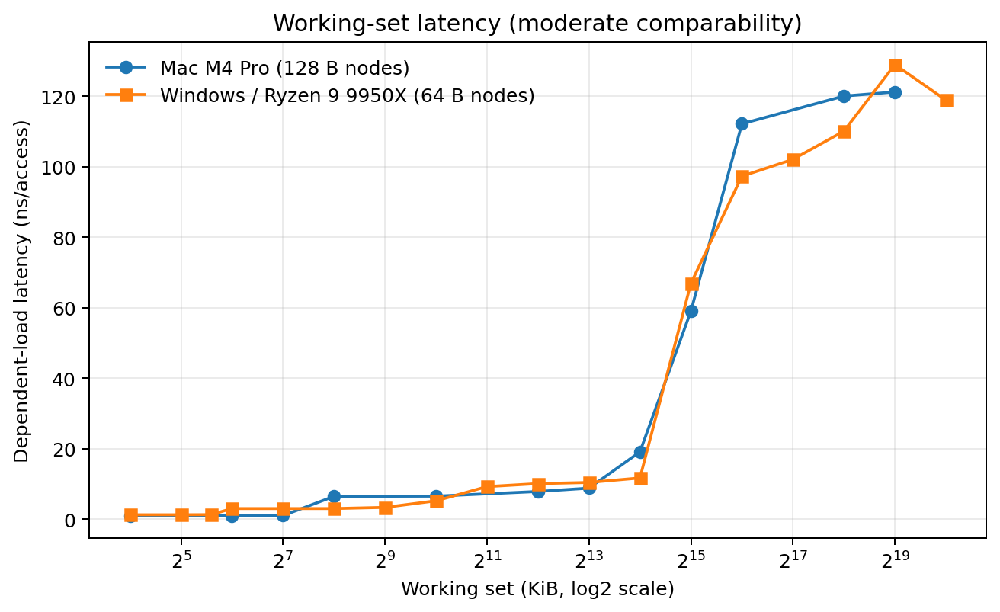
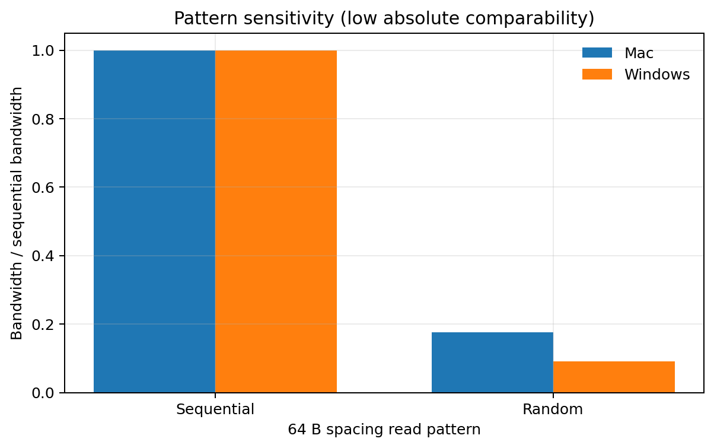
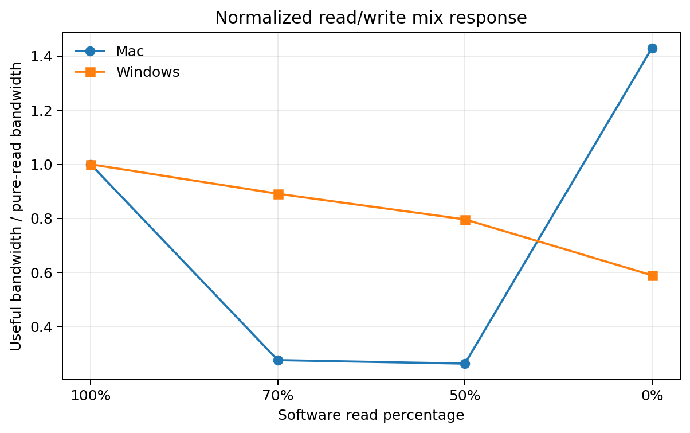
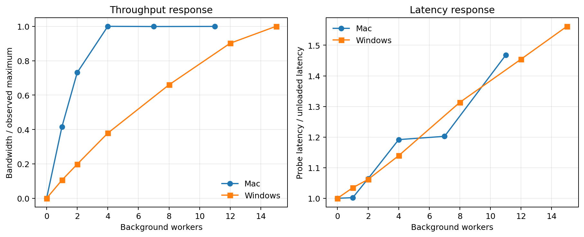

# Mac vs Windows Project 2 Comparison

## 1. Purpose

This report compares two independent implementations of the same ECSE 4320/6320 cache-and-memory profiling assignment: the Apple M4 Pro/macOS project in this folder and the AMD Ryzen 9 9950X/Windows project in [../../ecse6320-project2-memory/](../../ecse6320-project2-memory/). It uses committed processed data and reports only; neither benchmark campaign was rerun.

Comparability labels mean:

- **HIGH:** definitions, units, workload construction, scale, and statistics align closely.
- **MODERATE:** the experiment asks the same architectural question, but one or more controls differ.
- **LOW:** the trend may be instructive, but absolute numerical ranking would be misleading.

There are no high-comparability cross-platform numerical claims in this report. The independent implementations differ in payload accounting, node spacing, footprints, page sizes, core placement, and summary statistic.

## 2. Platforms

| Attribute | Mac | Windows/AMD |
|---|---|---|
| System | Mac16,8 | Custom Windows host |
| Processor | Apple M4 Pro, arm64 | AMD Ryzen 9 9950X |
| Cores / logical processors | 8 P + 4 E / 12, no SMT reported | 16 / 32, SMT enabled |
| Memory | 24 GiB unified memory | 4 × Micron 16 GiB; ~61.65 GiB OS-visible |
| Native page | 16 KiB | 4 KiB |
| OS | macOS 26.6.2, Darwin 25.6.0 | Windows 11 Enterprise build 26200 |
| Run policy | Battery; QoS hint; no hard pinning or frequency lock | Balanced plan; hard pinning; Hyper-V/VBS present |
| Cache topology recorded | 128 KiB P-core L1D; 16 MiB per four-P-core L2; 64 KiB E-core L1D; 4 MiB E L2 | Aggregate 1,280 KiB L1, 16 MiB L2, 64 MiB L3; two uProf cache domains |

The Mac evidence calls the memory unified. It does not justify attributing an observed result to GPU sharing or a particular system-level-cache capacity. The Windows evidence records one NUMA node but two uProf cache domains. These are relevant topology differences, not causal proofs.

## 3. Benchmark implementations

Both projects use native custom MLC-equivalent code, dependent pointer chains for approximately one-outstanding-load latency, streaming kernels, randomized orders generated before timing, background-worker load, and explicit result validation.

The Mac implementation is C11. Pointer nodes are normally 128 B apart; pattern bandwidth counts 8 useful payload bytes per access. A 256 MiB address span is used for pattern and mix studies. Page-locality layouts use compact 128 B nodes or one node per 16 KiB native page. The loaded experiment uses a 256 MiB dependent probe and private 128 MiB arrays for 0–11 workers.

The Windows implementation is C++. Its canonical pattern sweep uses a 1 GiB working set, 64-byte logical operations, and 64/256/1024 B strides. Dependent latency normally uses 64 B spacing. Its loaded experiment uses 0–15 pinned workers. These details are why raw bandwidth values are not treated as apples-to-apples.

## 4. Dependency/toolchain comparison

The Mac uses Apple Clang 21, Make, Python 3.13.15, Matplotlib 3.10.8, POSIX threads, macOS QoS/signposts, and Xcode/Instruments 26.0.1. The Windows project uses Clang 23.1.4, CMake, Ninja, Python 3.13.9 with NumPy/Pandas/Matplotlib, Windows APIs, and AMD uProf 5.3.521.0. See [dependency_comparison.md](dependency_comparison.md) for the full required/optional inventory.

## 5. Cache hierarchy latency

| Interpretation | Mac | Windows/AMD | Comparability |
|---|---:|---:|---|
| L1-compatible representative | 0.969 ns/access at 64 KiB | 1.262 ns/load at 16 KiB | MODERATE |
| L2-compatible representative | 7.836 ns/access at 4 MiB | 3.328 ns/load at 512 KiB | LOW |
| LLC/L3 representative | N/A; source avoids conventional L3 labeling | 11.973 ns/load at 16 MiB | Not numerically comparable |
| Large, memory-sensitive representative | 121.177 ns/access at 512 MiB | 111.876 ns/load at 512 MiB | MODERATE |

At the common 512 MiB footprint, the Mac value is 9.301 ns higher, 1.083× the Windows representative (+8.31%). Even this is moderate rather than high comparability: Mac nodes are 128 B apart and values are arithmetic means, while Windows nodes are 64 B apart and the canonical value is a median. The M4 report also warns that system-level cache, translation, and topology blur a simple L1/L2/L3 model.

## 6. Sequential vs random access

| Platform | Sequential | Random | Sequential/random ratio | Comparability |
|---|---:|---:|---:|---|
| Mac | 13.094 GB/s | 2.310 GB/s | 5.67× | LOW |
| Windows/AMD | 29.234 GiB/s | 2.641 GiB/s | 11.07× | LOW |

Both implementations show a sequential-locality advantage. Absolute differences and percentage differences are intentionally not reported: Mac counts 8 useful bytes per operation over a 256 MiB span, while Windows counts a 64-byte logical operation over 1 GiB. The normalized ratios are descriptive of each implementation, not a platform bandwidth ranking.

## 7. Stride sensitivity

| Stride | Mac GB/s | Mac / 64 B | Windows GiB/s | Windows / 64 B | Comparability |
|---:|---:|---:|---:|---:|---|
| 64 B | 13.094 | 1.000 | 29.234 | 1.000 | MODERATE for normalized trend |
| 256 B | 2.936 | 0.224 | 11.566 | 0.396 | MODERATE for normalized trend |
| 1024 B | 2.644 | 0.202 | 10.331 | 0.353 | MODERATE for normalized trend |

Both lose useful bandwidth as spacing grows. The Mac curve degrades more sharply relative to its 64 B case. This does not by itself prove a cache-line or prefetcher difference: Mac's source notes that its fixed address span changes the number of unique touched lines and that random indexing adds uncounted traffic.

## 8. Read/write and mixed workloads

| Software mix | Mac GB/s | Mac / pure read | Windows GiB/s | Windows / pure read | Comparability |
|---|---:|---:|---:|---:|---|
| 100% read | 96.068 | 1.000 | 31.954 | 1.000 | LOW |
| 70% read | 26.497 | 0.276 | 28.477 | 0.891 | LOW |
| 50% read | 25.264 | 0.263 | 25.450 | 0.796 | LOW |
| 0% read | 137.444 | 1.431 | 18.840 | 0.590 | LOW |

The response shapes differ dramatically. The Mac report provides a direct methodological warning: mixed-read loops were not vectorized while pure streaming paths had optimized/interleaved versions, and stores were ordered but not flushed to DRAM. Windows uses a different 64-byte operation definition and a 1 GiB footprint. These are software-operation results, not physical read/write bus ratios.

## 9. Loaded latency / concurrency

The Mac sweep rises from 0 to 236.29 GB/s and from 120.02 to 176.18 ns over 0–11 background workers. Its predefined first point at ≥90% of observed maximum is four workers (236.29 GB/s, 143.03 ns). The Windows sweep rises from 3.713 to 35.199 GiB/s and 128.16 to 193.45 ns over 1–15 workers; its predefined knee remained unresolved.

Relative to unloaded probe latency, the final sampled Mac point is 1.468× and Windows is 1.562×. These endpoints are **LOW** comparability because worker kernels, byte accounting, footprints, sampled counts, hard affinity, and core populations differ. On the Mac, the 11-worker case may include both P- and E-core placement, but the source does not establish exact placement, so no heterogeneous-core causal claim is made.

The Mac report's Little's Law illustration at its four-worker candidate is 33,798 useful bytes, or 264 nominal 128 B line-equivalents. Windows reports the formula with its own workload but does not claim a resolved knee. Neither value is measured queue occupancy.

## 10. Working-set transitions

The Windows curve changes around 48–64 KiB, 512 KiB–2 MiB, and 16–32 MiB. The Mac curve changes sharply from 128 KiB (1.004 ns) to 256 KiB (6.458 ns), and more broadly across 8 MiB (8.789 ns), 16 MiB (19.075 ns), 32 MiB (59.026 ns), and 64 MiB (112.137 ns).

The curves are **MODERATE** comparability as dependent-load working-set studies. Transition points do not prove exact cache capacities: placement, node spacing, translation, shared occupancy, and unmeasured system-level caching contribute.

## 11. Cache-counter evidence

Windows AMD uProf profiles provide supporting L1/L2 miss evidence, while direct L3/DF/UMC/controller events were unavailable. Mac guided Instruments profiles export L1D-related critical-stall percentages for selected multiply and page-locality cases. They are not raw miss counts. The custom Mac raw-event recording completed, but export failed with an `NSNull`/`NSString` conversion error; no individual data-TLB counts were validated.

The counter evidence is **LOW** cross-platform comparability because event definitions and measured quantities differ. It supports each project's internal interpretation but not a counter-to-counter ranking.

## 12. TLB/page-locality behavior

Windows measures one node per 4 KiB page: about 3.0 ns at 16–64 pages, rising to 18.257 ns at 16,384 pages. Mac uses 16 KiB native pages and compares compact and spread layouts: at 8,192 nodes it records 6.538 ns compact and 16.162 ns spread. At 4,096 spread nodes it records 15.834 ns.

This is **LOW** comparability. Equal page counts imply four times the address span on the Mac, and Mac compact/spread layouts also change cache mapping and footprint. Neither the cross-platform difference nor the within-Mac difference is labeled an isolated TLB penalty. Large pages were unavailable in both recorded configurations for different reasons: missing Windows privilege versus a rejected explicit Mac allocation.

## 13. Normalized comparisons

Normalization makes direction and shape easier to inspect, but it cannot repair incompatible workload semantics. The comparison dataset records every value, source, unit, label, and caveat in [mac_windows_project2_comparison.csv](../results/comparison/mac_windows_project2_comparison.csv). The strongest normalized comparison is stride degradation (**MODERATE**); pattern, mix, and loaded-concurrency normalizations remain **LOW**.

## 14. Interesting architectural and methodological contrasts

- The Mac has documented heterogeneous P/E cores without SMT; Windows has 16 cores/32 logical processors with SMT. Hard Windows affinity selects one logical processor per physical core, while Mac uses only an advisory QoS request.
- Mac records 128 B cache lines and 16 KiB pages; the Windows workload uses 64 B operation/node spacing and 4 KiB pages. This directly changes stride and page-locality interpretation.
- Mac's documented cache hierarchy is per-core/per-cluster and the report declines to invent a conventional L3 plateau. Windows explicitly studies representative L1/L2/LLC regions across two observed cache domains.
- The Mac uses unified memory; Windows uses four DIMMs. Neither benchmark measures physical DRAM traffic, so the result set does not establish a memory-controller bandwidth comparison.
- Compiler behavior is an explicit Mac confounder in the mixed workload. Both projects preserve counter and control limitations rather than turning them into causal claims.

## 15. Methodological differences that affect comparability

| Control | Mac | Windows/AMD | Effect |
|---|---|---|---|
| Timer | Monotonic clock | QPC | Similar elapsed-time goal |
| Latency spacing | 128 B | 64 B | Different cache-line/node use |
| Bandwidth payload | 8 useful B/access | 64 logical B/operation | Absolute rates are not equivalent |
| Pattern footprint | 256 MiB | 1 GiB | Different cache sensitivity |
| Summary | Mean ± sample SD, 3 runs | Median plus mean/SD/CV, usually 3; phase 1 has 5 | Central values differ |
| Pinning | None; QoS hint | Hard affinity | Mac has placement uncertainty |
| Page size | 16 KiB | 4 KiB | Page counts imply different spans |
| Power/control | Battery, unlocked | Balanced plan, Hyper-V/VBS retained | Different uncontrolled background factors |

## 16. Requirement coverage

| Requirement | Mac | Windows/AMD | Evidence / context |
|---|---|---|---|
| L1 latency | COMPLETE | COMPLETE | Dependent working-set sweeps |
| L2 latency | COMPLETE | COMPLETE | Qualified representative regions |
| LLC/L3 latency | NOT APPLICABLE / PLATFORM LIMITATION | COMPLETE | Mac source avoids unsupported conventional-L3 label |
| DRAM-sensitive latency | COMPLETE | COMPLETE | Large dependent chains |
| Sequential pattern | COMPLETE | COMPLETE | Native streaming sweeps |
| Random pattern | COMPLETE | COMPLETE | Indexed/randomized sweeps |
| 64 B / 256 B / 1024 B | COMPLETE | COMPLETE | Mac also includes 128 B |
| 100% read / 100% write / 70/30 / 50/50 | COMPLETE | COMPLETE | Software operation mixes |
| Working-set sweep | COMPLETE | COMPLETE | 16 KiB–512 MiB Mac; 16 KiB–1 GiB Windows |
| Intensity/concurrency sweep | COMPLETE | COMPLETE | 0–11 vs 0–15 workers |
| Throughput-latency knee | COMPLETE | COMPLETE | Mac candidate; Windows explicitly unresolved |
| Little's Law | COMPLETE | COMPLETE | Qualified illustrative reasoning |
| Cache-counter evidence | PARTIAL | PARTIAL | Different incomplete profiler evidence |
| TLB behavior | PARTIAL | COMPLETE | Mac lacks validated raw TLB counts |
| Huge/large pages | NOT APPLICABLE / PLATFORM LIMITATION | NOT APPLICABLE / PLATFORM LIMITATION | Allocation/support versus privilege blockers |
| Benchmark pitfall | COMPLETE | COMPLETE | Cache-sensitive/misleading cases retained |
| Repeated trials | COMPLETE | COMPLETE | Three per Mac setting; three/five Windows |
| Error bars / CV | PARTIAL | COMPLETE | Mac SD bars; Windows SD and CV |
| Pinning | PARTIAL | COMPLETE | QoS hint versus hard affinity |
| Reproducibility | COMPLETE | COMPLETE | Source, commands, validation |
| Raw data | COMPLETE | COMPLETE | Raw measurement artifacts retained |
| Processed data | COMPLETE | COMPLETE | Canonical CSVs |
| Plotting code | COMPLETE | COMPLETE | Python/Matplotlib |
| Environment capture | COMPLETE | COMPLETE | Platform-specific records |
| AI-use statement | COMPLETE | COMPLETE | Original disclosure retained |

## 17. Reproducibility comparison

The Mac timing suite needs Apple Clang, Make, Python, and Matplotlib, while counter reproduction additionally needs compatible Xcode/Instruments. The Windows suite needs Clang, CMake/Ninja, Python scientific packages, and optionally AMD uProf. Both run without elevation for their measured baseline. The Windows environment offers stronger placement control; the Mac project has fewer Python dependencies but a more fragile profiler-export path.

## 18. Limitations and conclusions

The most defensible common finding is qualitative: dependent latency changes strongly with working set, sequential locality beats random access, larger strides reduce useful bandwidth, and background concurrency trades throughput against probe latency. The working-set curves and normalized stride response have moderate comparability. Absolute bandwidth, mixed read/write behavior, loaded throughput, counter values, and page/TLB results have low comparability.

No result here establishes that one processor has categorically better memory performance. The projects measure different software interfaces on different operating systems with materially different workload semantics. Their real value together is methodological: they show which trends survive platform changes, and exactly where apparently simple cross-machine numbers stop being equivalent.
