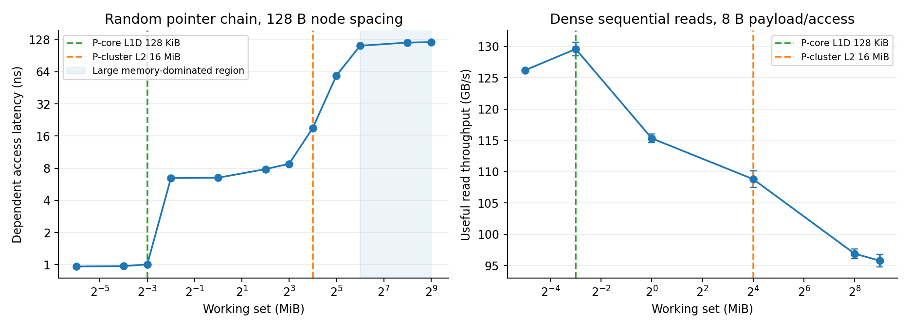
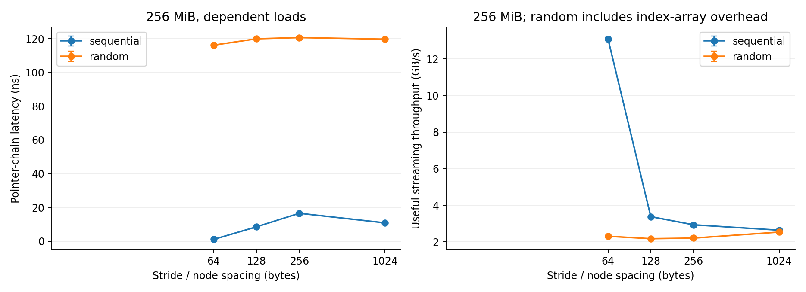
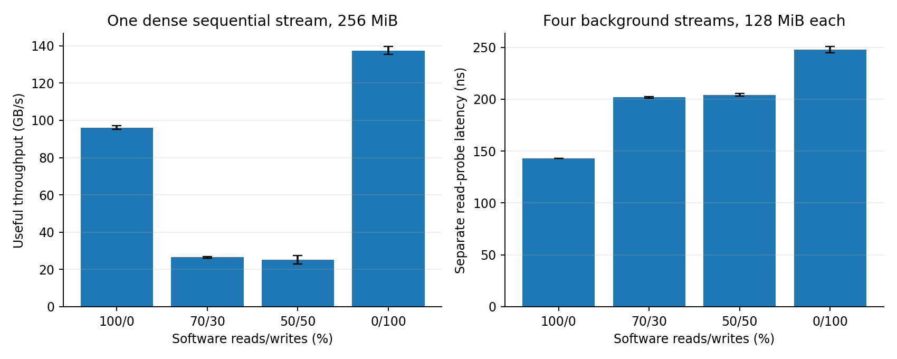
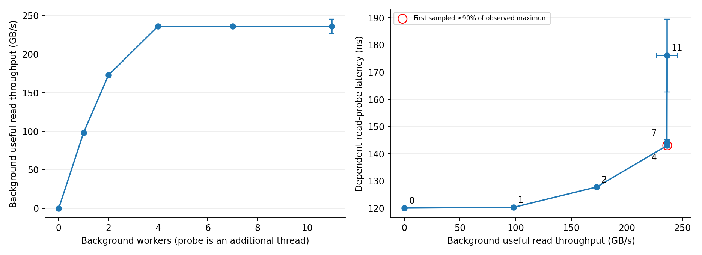
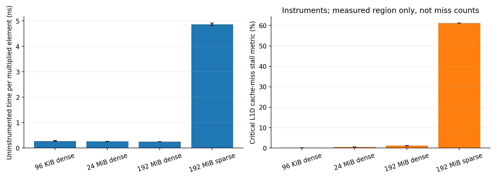
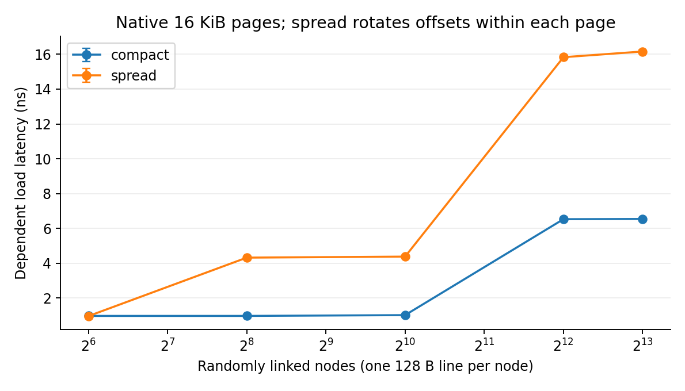
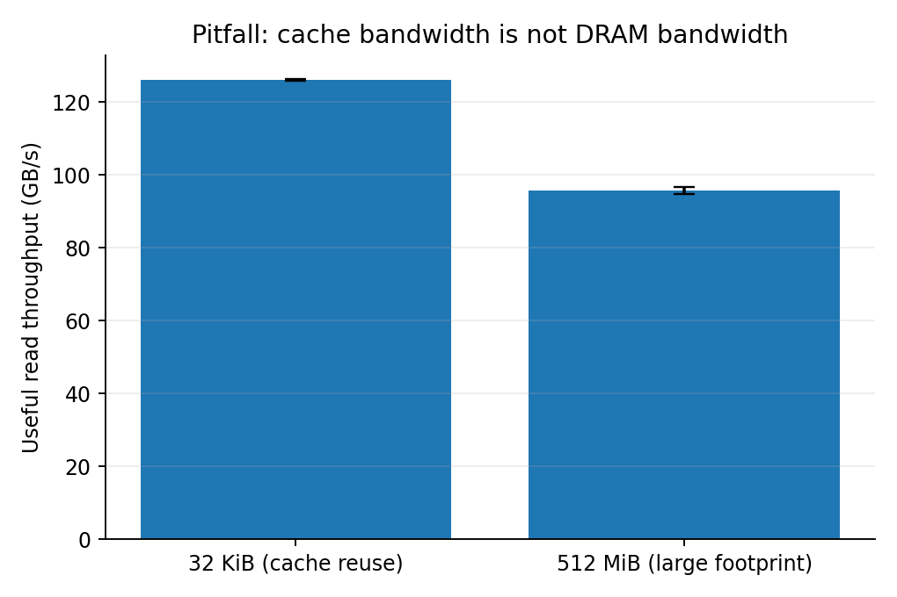

# Project #2 — Compact Cache & Memory Profiling

**Platform:** Apple M4 Pro, 24 GB unified memory, macOS 26.6.2.  
**Scope:** time-boxed targeted sweeps, not an exhaustive factorial experiment.  
**Raw run:** `20261023-150209`; 186 uninstrumented measurements; three trials per setting.

## 1. Questions, hypotheses, and method

`HYPOTHESES.md` was written before this suite. The expected trends were cache-capacity
steps, sequential/prefetch advantages, diminishing bandwidth returns under load,
and worse locality when nodes span more pages. Unexpected trends are retained.

The native C benchmark is built with Clang `-O3 -g -std=c11 -pthread`, with warnings
treated as errors. Timing uses `CLOCK_MONOTONIC`; latency is reported in nanoseconds,
not converted using an assumed CPU frequency. The ARM timer frequency is not the CPU
clock. Pointer chasing has one dependent chain, so it suppresses intentional
memory-level parallelism and approximates an unloaded baseline, not guaranteed
hardware zero-queue latency. The ring is traversed before timing to warm mappings
and validate a single cycle. Arrays are initialized before timing; page faults are
not intentionally included. C assertions validate ring topology, mixed read/write
operations against a scalar reference, and every accessed multiply result.

All plots use arithmetic mean ± sample standard deviation over three independent
process runs. These are variability bars, not confidence intervals. Trials use
recorded seeds and shuffled order with a 0.1 s inter-run pause. Most timed regions
last at least 0.18 s; load tests last at least 0.4 s. A streaming pass is never cut
short, so some actual durations exceed the requested minimum. Each profile lasts
2 s, with setup excluded using signposts.

**Hardware/control:** 8 performance and 4 efficiency cores; 12 physical and 12
logical cores (no SMT). P-core L1D: 128 KiB/core; P-cluster L2: 16 MiB per four-core
group. E-core L1D: 64 KiB/core; E-cluster L2: 4 MiB. Cache lines: 128 B; native pages:
16 KiB. A user-interactive QoS hint is requested, not hard CPU pinning. Frequency
and thermals are not locked; OS activity is not isolated. No NUMA binding was
applied on this unified-memory host. Exact power-source/policy, memory-pressure,
swap, tool-version, and before/after system records are in the raw run directory.
**Recorded power source:** Now drawing from 'Battery Power';  -InternalBattery-0 (id=23199843)	51%; discharging; 7:43 remaining present: true. **Swap at the end:** total = 0.00M  used = 0.00M  free = 0.00M  (encrypted).
The host had other applications running; Instruments also observed unrelated
background signposts. No privileged settings or security controls were changed.

## 2. Near-unloaded latency and working-set transitions

| Interpretation, not guaranteed residency | Footprint (MiB) | Mean latency ± SD (ns) |
| --- | --- | --- |
| L1-compatible | 0.0625 | 0.97 ± 0.02 |
| L2-compatible | 4 | 7.84 ± 0.05 |
| Beyond cluster L2; mixed SLC/translation | 64 | 112.14 ± 0.21 |
| Large, memory-dominated | 512 | 121.18 ± 0.22 |

The 64 KiB result is 0.97 ns/access. At 512 MiB the
dependent chain reaches 121.18 ± 0.22 ns/access. The known 128 KiB and 16 MiB
capacity boundaries are annotated, but capacity alone does not prove residency.
The shared L2 has competing occupants, and translation/prefetch/system-level-cache
effects can blur transitions. Apple does not expose a conventional Intel-style
L3 here; the 64 MiB region is not relabeled L3 or presented as an isolated SLC hit.
Large-footprint latency still includes address translation and loop overhead.
The sharp change from 128 KiB (1.00 ns)
to 256 KiB (6.46 ns) is consistent with
leaving P-core L1D. The 8/16/32 MiB points are
8.79/19.08/59.03 ns,
showing a broader shared-cache/translation transition, not three separately
identified cache levels.

For AMAT-style reasoning, use
`T ≈ L1_hit + m1 × (L2_increment + m2 × memory_increment)` under a consistent
conditional-miss definition. The measured small and large regimes show the size
of potential miss penalties. We do not fit numerical miss probabilities because
raw per-level miss counts were not recovered. Overlap and prefetching also mean
streaming runtime is not simply one AMAT multiplied by the number of accesses.

## 3. Patterns, strides, and software read/write mixes

Each access carries 8 useful bytes. At 64 B spacing, two adjacent nodes can share
one 128 B line; at 256/1024 B, most bytes fetched with a line are unused. Sequential
chains are prefetch-friendly; shuffled chains are dependent and irregular. Random
streaming additionally reads a shuffled index array, whose footprint is
`8 × node_count` bytes and whose traffic is **not** included in useful bandwidth.
Thus its result measures the indexed algorithm, not an isolated DRAM transaction.
The 256 MiB backing address span is fixed, not the unique touched-line footprint:
at 128/256/1024 B spacing, one pass touches about 256/128/32 MiB of cache lines.
Consequently a stride-dependent change can include cache reuse, not only wasted
line bytes. No claim that every sparse point measures purely DRAM is made.
One non-monotonic result is the sequential chain at 256 B versus 1024 B spacing:
16.54 versus 10.87 ns.
Fewer touched lines, prefetch behavior, and translation/cache indexing can explain
why a larger stride is not necessarily slower; this suite does not separate them.

| Software R/W (%) | One-stream useful GB/s | Read-probe ns under four workers |
| --- | --- | --- |
| 100/0 | 96.07 | 143.18 |
| 70/30 | 26.50 | 201.82 |
| 50/50 | 25.26 | 204.09 |
| 0/100 | 137.44 | 247.71 |

These are separate experiments: the left panel measures throughput of a single
stream; the right uses a dependent read probe alongside four background streams
with the named mix. It does not report store-completion latency or pretend that
the two panels share the same concurrency. Mixed kernels issue the requested
operation proportions in groups of ten (with a tiny partial-group tail).
Loads and stores can generate write allocations, dirty evictions, and writeback;
100% software writes is not 100% DRAM write traffic. The fence orders stores but
does not flush all dirty lines to DRAM. Compiler/code-path differences and loop
overhead also contribute to mix differences. Compiler optimization remarks
(`vectorization.log`) show mixed-read inner loops were not vectorized while
pure streaming paths have optimized/interleaved versions. The mixed-stream
results therefore cannot be interpreted as pure DRAM mix penalties.

All bandwidth values are **application useful GB/s**, with `GB = 10^9 bytes`;
footprints use binary KiB/MiB. Physical DRAM bus bandwidth was not measured.

## 4. Loaded latency, saturation candidate, and Little's Law

| Background workers | Useful background GB/s | Read-probe ns |
| --- | --- | --- |
| 0 | 0.00 | 120.02 |
| 1 | 98.08 | 120.28 |
| 2 | 172.72 | 127.73 |
| 4 | 236.29 | 143.03 |
| 7 | 235.99 | 144.31 |
| 11 | 236.15 | 176.18 |

Each worker scans its own 128 MiB array; the independent probe uses 256 MiB.
Up to 11 workers plus the probe use roughly 1.63 GiB of backing arrays. Workers
check a stop flag between 512 KiB chunks. The probe interval and the background
finish interval differ by at most the stop/drain tail; their timings are recorded
separately. More workers are not the same as a known number of outstanding requests.
At the largest count both core types can participate, and scheduler contention
can raise probe latency as well as memory queuing.

The first sampled level reaching at least 90% of the observed maximum is
**4 workers**, at **236.29 GB/s**
and **143.03 ns**. This is a predefined, discrete
**saturation candidate**, not proof of a hardware queue-depth knee.
Later sampled load raises latency by more than 15%, consistent with diminishing returns.
The largest observed probe latency is 176.18 ns versus
120.02 ns without background workers. A higher worker
count can change core placement and instruction overhead, so causality is qualified.
The 11-worker point also has larger latency variability; its error bar is retained
rather than interpreting the mean alone as a pure DRAM queuing penalty.

Little's Law is `Q = λW`, or `bytes_in_flight = bandwidth × mean_request_latency`
for the **same steady-state request population**. At the candidate,
`236.29 GB/s × 143.03 ns`
equals approximately **33798 bytes**, or **264.0 128-B-line
equivalents**. This is an illustrative pressure proxy only: useful background bytes
are not measured physical traffic, and dependent probe latency need not equal
background-request latency. It is not a measured MLP/queue-occupancy result.

## 5. Cache-related counter evidence and kernel performance

| Multiply footprint/access | ns per element | Useful GB/s (24 B/element) |
| --- | --- | --- |
| 96 KiB dense | 0.278 | 86.65 |
| 24 MiB dense | 0.259 | 92.81 |
| 192 MiB dense | 0.255 | 93.99 |
| 192 MiB sparse | 4.871 | 4.93 |

The kernel is `z[i] = x[i] * y[i]`; its footprint is the sum of all three arrays.
Sparse access uses a 128 B stride in each array, versus 8 B dense access. Every
computed result is checked outside timing. The dense large/small time-per-element
ratio is 0.92×; this includes instruction throughput, locality, and bandwidth
effects and is not assigned exclusively to cache misses.
The dense large kernel did not show the expected slowdown relative to the small kernel. This is a retained negative result: efficient streaming, instruction-issue limits, and per-pass overhead can mask a capacity effect in ns/element. The sparse large kernel is much slower and has a less locality-friendly access regime.
Compiler remarks mark the runtime-stride multiply loop as not loop-vectorized;
the scalar/unrolled instruction stream may limit dense throughput even in cache.

| Profile | Trials | Critical L1D stall (%) | P-core sampled time (%) |
| --- | --- | --- | --- |
| kernel_small | 3 | 0.11 ± 0.04 | 100.0 |
| kernel_medium | 3 | 0.59 ± 0.02 | 100.0 |
| kernel_large | 3 | 1.16 ± 0.10 | 100.0 |
| kernel_sparse | 3 | 61.19 ± 0.02 | 100.0 |
| pages_compact | 3 | 59.46 ± 0.08 | 100.0 |
| pages_spread | 3 | 29.16 ± 0.25 | 100.0 |

Apple Instruments' guided **Instruction Processing** mode supplies the table's
hardware-derived stall percentages. Exported metric legends identify Executing,
Execution Latency, Critical L1D Cache Miss, Critical L1D Cache Miss While Executing,
and Non-Critical L1D Cache Miss. Integer arrays are basis-point metrics; the parser
checks their length and normalization and duration-weights them over the marked
measurement interval. “Critical L1D” is a stall attribution, **not a miss count,
miss probability, or cycles-per-miss measurement**. The raw XML, legends, traces,
profiled runtimes, and sampled P/E-core fractions are retained. Correlation across
footprints/patterns is informative but does not by itself establish causality.
The profile window differs from the shorter uninstrumented run; profiler timing
is not substituted into the baseline measurements.
The descriptive Pearson correlation across the four kernel settings between
uninstrumented ns/element and the critical-L1D stall metric is
**0.9998**. This is
dominated by the sparse point. With only
four different kernels/access regimes, this is a descriptive association, not
a statistical or causal proof. Low stall fraction does not imply few misses:
overlap, code generation, store work, and execution limits affect the denominator.

The manual raw-event configuration recorded, but its export aborted with a
`NSNull`/`NSString` cast error. The successful guided path is partial counter
coverage: direct cache/TLB miss counts, instruction counts, CPU cycles, and DRAM
controller traffic are not claimed. This leaves part of the rubric's requested
counter correlation incomplete, particularly data-TLB attribution.

**Why data-TLB miss counts are missing:** the local CPU event database exposes
data-TLB events, including `L1D_TLB_MISS_NONSPEC` and `L2_TLB_MISS_DATA`.
The custom configuration requested these events and recording completed, but the
command-line exporter crashed before individual counts could be extracted and
validated. This does **not** establish that the M4 lacks TLB counters. The failure
may involve the generated template or Instruments compatibility; the root cause
has not been established. The working guided mode exports cache-related stall
percentages, not data-TLB miss counts. Page-locality timing differences are
therefore not labeled as measured TLB misses.

## 6. Page locality and huge-page limitation

For 8192 nodes, compact versus spread latency is
**6.54 versus 16.16 ns**.
Both touch 8192 lines and the same useful pointer bytes, but compact storage spans
1 MiB (64 native pages) and spread storage 128 MiB (8192 pages). Spread rotates
the within-page line offset instead of placing every node at offset zero. This
reduces a naive same-cache-set confound but cannot equalize all cache indexing,
physical placement, or prefetch behavior. Any slowdown is a page-locality result,
not a measured isolated TLB-miss penalty. Cache stall profiles for the pair help
expose residual cache confounding, but do not replace data-TLB counts.
At only 256 nodes, both layouts touch about 32 KiB of cache lines, while spanning
2 compact pages versus 256 spread pages. Their measured latencies are already
0.97 versus 4.32 ns.
That is consistent with translation pressure appearing before a data-cache capacity
change, but is not enough to assign an exact TLB capacity or miss penalty.
For the profiled 8192-node pair, the critical-L1D stall fraction is 59.5% compact versus 29.2% spread. A fraction can fall because other stalls grow; it does not establish that miss counts fell. Translation effects cannot be inferred by treating that cache-stall percentage as a TLB counter.

Native pages are 16 KiB, not 4 KiB. Earlier feasibility checks accepted an ordinary
allocation and rejected explicit 2 MiB superpages with `KERN_INVALID_ARGUMENT`.
No huge-page result is invented. The PDF makes huge-page evaluation conditional
on availability; page locality is still tested on the real platform.

**Availability, not a longer-running benchmark:** the tested explicit 2 MiB
allocation path failed. Waiting longer would not make that request succeed.
No supported alternative allocation method has been established on this setup;
this is not proof that every possible large-page mechanism is unavailable.

### Follow-up estimates and grading implications (not measured results)

- On an already-configured bare-metal Linux machine with verified huge-page
  support, budget roughly **10–20 minutes** to adapt the test, verify actual
  huge-page allocation, run three trials, and plot the comparison. This is a
  planning estimate, not a measured runtime, and excludes machine/tool setup.
- On this Mac, there is **no reliable huge-page completion estimate** until a
  supported allocation method is found. Repeating a rejected allocation for
  longer is not useful.
- A further TLB-counter attempt could use an Instruments GUI-saved configuration
  or another collector, which may require administrator access. Budget
  **15–30 minutes of investigation**, with **no guarantee of success**. Neither
  alternative was validated in this compact study.
- The PDF explicitly conditions huge-page evaluation on availability. Missing
  direct TLB-counter evidence is the more important unresolved grading risk:
  it weakens the **35-point working-set/cache/TLB analysis category**. The PDF
  does not specify deductions within that category, so losing all 35 points
  is not assumed. No additional measurements are claimed by this update.

## 7. A deliberately misleading bandwidth claim

The same dense read loop delivers **126.20 GB/s** at
32 KiB versus **95.79 GB/s** at 512 MiB
(1.32× ratio).
Repeated passes over the small footprint reuse cache. Reporting its speed as
DRAM bandwidth would therefore be wrong. The correction is to sweep footprint,
use a large working set, retain the cache-resident control, and label useful
traffic rather than claim unmeasured memory-controller bandwidth. The full plot
is retained even if the expected bandwidth ordering is weak or reversed.

## 8. Limitations and AI-use transparency

- Three short trials give limited statistical power. No confidence or full-credit claim is made.
- Background OS work, DVFS, thermal drift, core migration, shared caches, and profiling
  overhead can affect results. QoS is not pinning, and no isolation was achieved.
- Apple system-level caching and native 16 KiB pages differ from a typical x86/Linux lab.
- Application bandwidth and stall metrics do not replace physical DRAM traffic or
  raw cache/TLB miss rates. No conventional L3, huge-page comparison, AMAT fit, or
  actual queue occupancy is fabricated.
- This compact suite deliberately avoids a full cross-product of all knobs. The
  read/write latency probe and throughput tests use different concurrency, as labeled.
- AI assistance (OpenAI GPT-6.1 Sol Fast through OpenCode) wrote the benchmark,
  scripts, plots, and this report and executed the automated checks/measurements.
  The failed manual-counter approach was rejected in favor of exportable guided
  metrics. Student understanding and independent review are still required before
  submission; automated AI-run assertions are not represented as human validation.

## Reproduction and evidence

See `README.md`, `Makefile`, `src/bench.c`, and `scripts/`. Raw commands, trial
outputs, system snapshots, profiler XML/trace files, and the shuffled plan are
under `data/raw/20261023-150209/`. Aggregates are under `data/processed/`, with PNG
and PDF plots under `plots/`. Prior feasibility failures are retained separately
under `validation/`. The assignment source is
`ECSE4320_6320_Class-wide_Projects.pdf`, pages 1 and 4–5.
