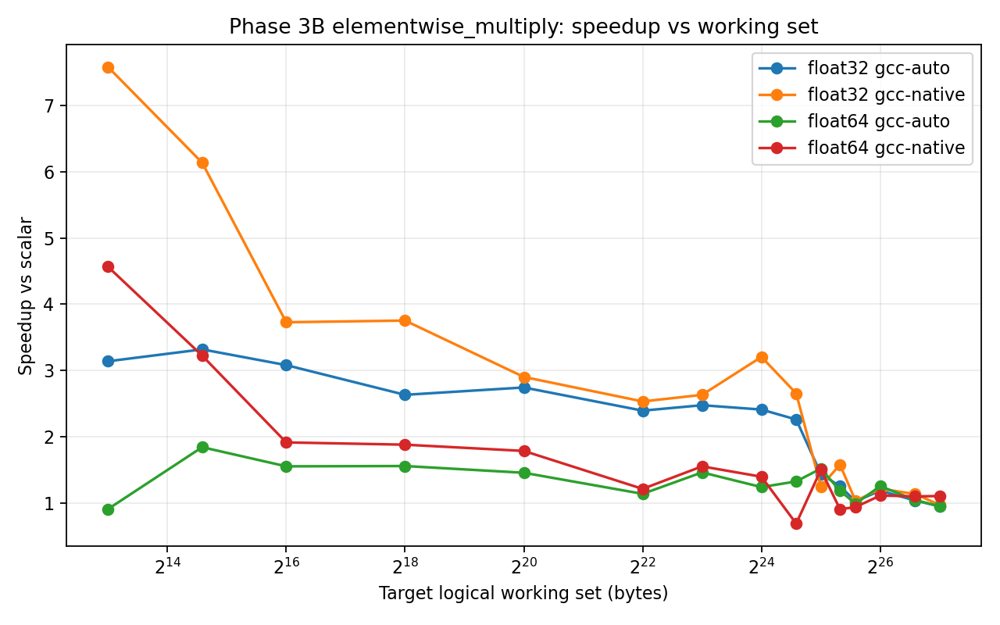
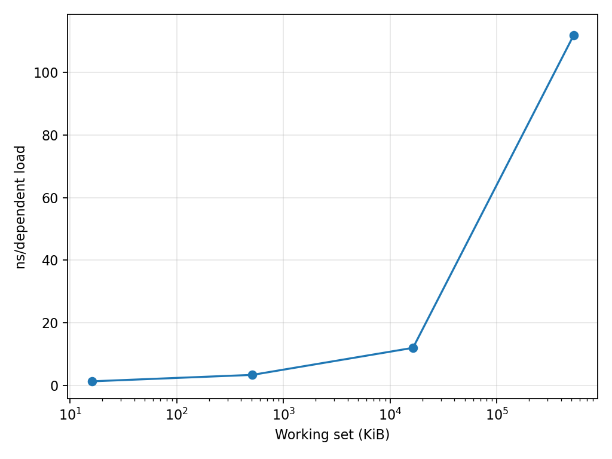
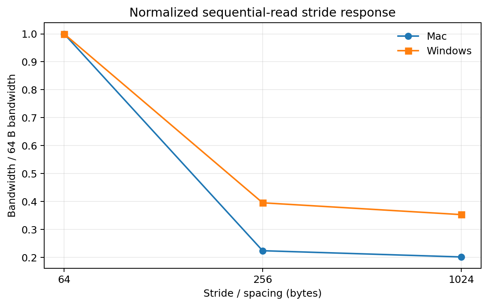
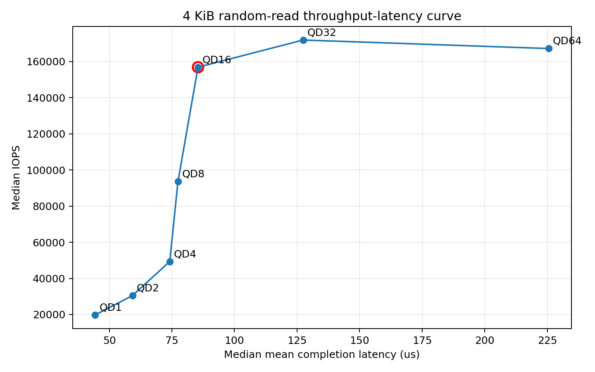

# ECSE 6320 — Advanced Computer Systems: Class-wide Projects

This repository contains three class-wide architecture and performance-characterization projects, plus a second Project 2 implementation measured independently on an Apple M4 Pro MacBook. Every project emphasizes controlled measurement, correctness, reproducibility, architectural interpretation, explicit limitations, and transparent AI-use documentation.

## Projects

| Project | Topic | Platform |
|---|---|---|
| [Project 1](ecse6320-project1-simd/) | SIMD Advantage Profiling | AMD Ryzen 9 9950X / Windows |
| [Project 2](ecse6320-project2-memory/) | Cache & Memory Profiling | AMD Ryzen 9 9950X / Windows |
| [Project 2 (Mac)](Project2_Mac/) | Cache & Memory Profiling | Apple M4 Pro / macOS |
| [Project 3](ecse6320-project3-ssd/) | SSD Performance Profiling | KIOXIA NVMe / Windows |

## Test system

| Component | Platform |
|---|---|
| CPU | AMD Ryzen 9 9950X |
| Cores / threads | 16 / 32 |
| RAM | ~61.65 GiB OS-visible |
| OS | Windows 11 Enterprise |
| SSD | KIOXIA KXG80ZNV1T02 REV2 NVMe |
| Primary profiler | AMD uProf 5.3.521.0 |
| Analysis | Python 3.13.9, NumPy, Pandas, Matplotlib |

## Results at a glance

### Project 1 — SIMD

| Result | Measurement |
|---|---:|
| Small-working-set native elementwise speedup | 6.138× |
| Intermediate native speedup | 2.652× |
| Native speedup at 128 MiB | 0.969× |
| Vector widths | Native 512-bit ZMM; auto primarily 128-bit XMM |

Wide SIMD produced large cache-resident gains but little benefit for the largest streaming working set.

### Project 2 — Memory

| Result | Measurement |
|---|---:|
| L1 / L2 / LLC / DRAM-sensitive latency | 1.262 / 3.328 / 11.973 / 111.876 ns/load |
| Sequential / random 64-byte read | 29.234 / 2.641 GiB/s |
| Loaded worker bandwidth | 3.713 → 35.199 GiB/s |

Memory performance depends strongly on hierarchy level, locality, and concurrency.

## Cross-platform Project 2 comparison

The Mac and Windows implementations ask the same broad questions with independent native benchmarks. Their dependent working-set curves and normalized stride response support a careful trend comparison. Absolute bandwidth, read/write mix, loaded throughput, and TLB results are less comparable because useful-byte definitions, footprints, page sizes, placement controls, and summary statistics differ.

| Comparison | Mac | Windows/AMD | Confidence |
|---|---:|---:|---|
| 512 MiB dependent latency | 121.177 ns/access | 111.876 ns/load | Moderate |
| Sequential/random ratio at 64 B spacing | 5.67× | 11.07× | Low |
| Bandwidth retained at 256 B vs 64 B stride | 22.4% | 39.6% | Moderate |
| Final loaded / unloaded probe latency | 1.468× | 1.562× | Low |

Read the [full Mac vs Windows report](Project2_Mac/docs/MAC_VS_WINDOWS_COMPARISON.md) for workload definitions, provenance, requirement coverage, and limitations.

### Project 3 — SSD

| Result | Measurement |
|---|---:|
| Maximum 4 KiB random-read IOPS | 171,868 at QD32 |
| Maximum 128 KiB sequential read | 5,158.6 MiB/s at QD32 |
| Throughput-latency knee | QD16 |
| Direct / immediate second buffered read | 630.5 / 7,420.3 MiB/s |

Increasing concurrency improved SSD utilization until diminishing throughput returns coincided with sharply increasing latency.

## Reproducibility

Each project contains source code, scripts, raw and processed data, plots, tables, methodology, environment records, and reproduction information. Start with the [Project 1 methodology](ecse6320-project1-simd/docs/methodology.md), [Windows Project 2 reproduction guide](ecse6320-project2-memory/docs/reproduction.md), [Mac Project 2 guide](Project2_Mac/README.md), and [Project 3 reproduction guide](ecse6320-project3-ssd/docs/reproduction.md).

## Source project snapshots

| Project | Source commit |
|---|---|
| Project 1 | `d9c07ecfd482c9942b83c74cdc157901e2c26ebc` |
| Project 2 | `4e9756ac608fe380bc4ad63e49c8122c61636f61` |
| Project 2 (Mac) | Non-Git source copy; inventory recorded in `Project2_Mac/docs/source_inventory.md` |
| Project 3 | `1dfbb2ef9582806410e53c2ec95f241bf6680c9d` |

The unified repository was assembled from clean committed Windows snapshots and a read-only curated Mac source copy. The original source directories were not modified.

## Limitations

Measurements were made on native Windows with the Balanced power plan retained; Hyper-V/VBS and profiler limitations are documented per project. Useful/effective bandwidth is not necessarily physical memory or storage traffic. SSD testing used safe regular-file direct I/O rather than raw-device access. Noisy or inconclusive findings were retained rather than discarded.

## AI use

AI/Codex assisted with coding, experiment orchestration, parsing, plotting, and documentation. Measurements and architectural claims were checked against correctness tests, compiler/disassembly evidence, benchmark raw data, AMD uProf reports, and FIO output as appropriate. AI did not independently verify undocumented hardware internals.
