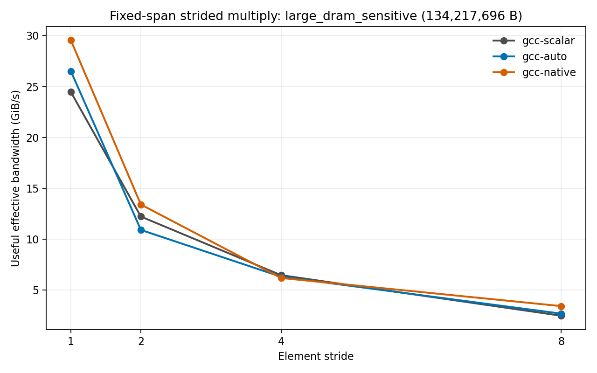
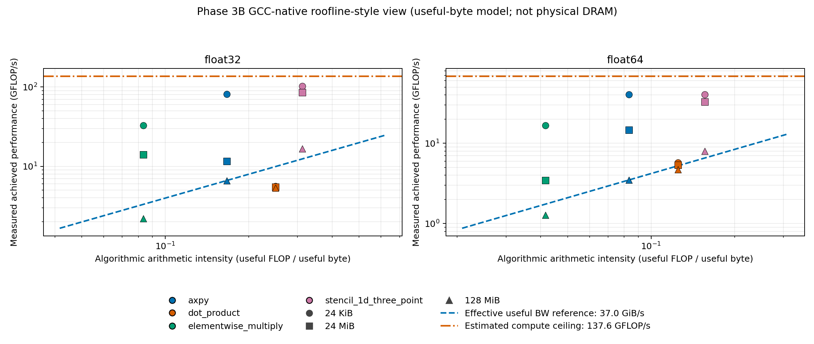

# Project 1 — SIMD Advantage Profiling

## Overview

This project compares scalar code, GCC auto-vectorization, and CPU-native AVX-512 across four numerical kernels and two datatypes. It measures how working-set size, cache/data supply, alignment, tails, and stride change SIMD benefit; verifies generated XMM/ZMM instructions using compiler reports and disassembly; builds a useful-byte roofline-style synthesis; and uses AMD uProf as process-level architectural evidence.

## Key results

| Result | Measurement |
|---|---:|
| Small-working-set float32 elementwise multiply native speedup | 6.138× |
| Intermediate native speedup | 2.652× |
| 128 MiB native speedup | 0.969× |
| Small stride-1 native speedup | 5.380× |
| Large-working-set SIMD result | Approximately no speedup |
| Native vector width | 512-bit ZMM |
| GCC auto vector width | Primarily 128-bit XMM |

## Important conclusions

- SIMD helps strongly when data supply is sufficient, but vector width does not imply proportional speedup.
- Large streaming working sets compressed the benefit; the 128 MiB native result was approximately parity with scalar.
- Non-unit strides selected scalar paths in the tested runtime kernel.
- Alignment and tail effects were not cleanly resolvable above measurement noise.
- Useful/effective bandwidth is algorithmic traffic divided by time, not physical DRAM bandwidth.

[Final tables](results/tables/FINAL_TABLES.md) · [Final figure index](results/plots/FINAL_FIGURES.md)

### Representative figures

**SIMD speedup versus working set**


**Large-span stride behavior**



**Useful-byte roofline-style synthesis**



---

**Final report.** Phases 0–6 are complete. Phase 6 adds documentation, indexes, and a requirements audit only; no new benchmark or profile was collected. The Phase 5B analysis was committed first (`6e69869`), followed by the final report commit.

This report compares scalar, compiler auto-vectorized, and CPU-targeted implementations of four numerical kernels, then evaluates how datatype, working set, alignment, tails, and stride affect measured performance. The full evidence and caveats are indexed in [the final requirement audit](docs/final_requirement_audit.md), [figure index](results/plots/FINAL_FIGURES.md), and [table index](results/tables/FINAL_TABLES.md).

## Objective

Determine when SIMD improves these kernels and when the expected lane-width advantage is limited by the loop, memory/data supply, workload size, or compiler-selected path. The report uses correctness checks, vectorization reports and disassembly, benchmark data, and representative AMD uProf process profiles. Effective bandwidth means useful algorithmic bytes divided by elapsed time, not physical DRAM bandwidth.

## Pre-Experiment Hypotheses

The statements below reproduce the pre-measurement hypotheses in [docs/hypotheses.md](docs/hypotheses.md); they have not been rewritten to match results.

| # | Original hypothesis | Outcome |
|---|---|---|
| 1 | SIMD should outperform scalar code when data supply is sufficient. | Qualified support: strong small-span AXPY, elementwise, and stencil speedups; dot product remained near 1x. |
| 2 | SIMD gains should compress for large DRAM-resident streaming workloads. | Qualified support: gains compressed at 128 MiB, but DRAM residency/saturation was not directly established. |
| 3 | float32 may outperform float64 because of more lanes and fewer bytes per element. | Qualified support: float32 was often faster per element, not universally; kernel and build mattered. |
| 4 | Misalignment may cause some overhead, but not necessarily a large penalty. | Inconclusive: alignment contrasts were noisy and did not establish a stable penalty or benefit. |
| 5 | Tail handling should matter most for small arrays and become less important for large arrays. | Inconclusive: measured tail curves were non-monotonic and variability exceeded the small added-work share. |
| 6 | Larger stride should reduce cache-line utilization and effective SIMD efficiency. | Supported with a compiler-path qualification: useful bandwidth fell, and auto/native selected scalar paths for non-unit strides. |
| 7 | Streaming kernels should become memory-bound sooner than kernels with more arithmetic per byte. | Qualified: streaming speedups compressed more, but the measurements do not isolate a physical memory-bound regime. |
| 8 | A large vectorized streaming kernel should provide a useful negative case where SIMD speedup is much smaller than vector width suggests. | Supported: native packed float32 elementwise multiply measured 0.969x scalar at 128 MiB; the difference is unresolved within CV. |
| 9 | GCC and Clang may generate different SIMD code, so emitted instructions must be verified. | Confirmed: reports/disassembly differ by compiler and kernel; Clang retained scalar dot under strict FP. |
| 10 | Working-set sweeps should reveal approximate cache/DRAM regime transitions, although boundaries may be blurred. | Partially supported: throughput trends vary by working set, but exact cache/DRAM boundaries were not identified. |

## Environment

Measurements were collected on native Windows 11 Enterprise (build 26200), AMD Ryzen 9 9950X, 16 cores/32 logical processors, and approximately 61.7 GiB installed memory. Tool versions: GCC/G++ 16.2.0 (MSYS2 UCRT64), Clang 23.1.4, CMake 4.4.4, Ninja 1.13.2, Python 3.13.9, GNU objdump 2.47, and AMD uProf 5.3.521.0. Windows reported 4.3 GHz maximum clock; this is not a measured sustained frequency. Hyper-V was reported active during uProf profiles. Full inventory: [docs/environment.md](docs/environment.md).

## Kernels and Arithmetic

The tested kernels are AXPY (`y[i] = a*x[i] + y[i]`), dot product (`sum += x[i]*y[i]`), elementwise multiply (`z[i] = x[i]*y[i]`), and a three-point 1D stencil (`y[i] = a*x[i-1] + b*x[i] + c*x[i+1]`). Both float32 and float64 were implemented. The stencil copies input endpoints to output and computes the formula for interior elements. Independent long-double-accumulating references and deterministic inputs are used for correctness.

Arithmetic intensity is useful floating-point operations per useful logical byte. AXPY is 2/12 = 0.1667 FLOP/B for float32 and 2/24 = 0.0833 for float64; dot is 2/8 = 0.25 and 2/16 = 0.125; elementwise multiply is 1/12 = 0.0833 and 1/24 = 0.0417. The stencil tends to 5/16 = 0.3125 and 5/32 = 0.15625 FLOP/B, respectively. These algorithmic counts omit cache-line overfetch, write allocation, and other physical traffic.

## Methodology

The Phase 3 full matrix covered four kernels, two datatypes, three GCC variants, and 15 working-set targets. It collected 3,600 timed observations: three warmups and ten repetitions per configuration. Calls were batched 128 times through N=4,096, 32 times through N=65,536, and once above; one thread was pinned to logical CPU 0. Allocation, initialization, AXPY reset, checksum traversal, and CSV output were outside the timed region. The timer was `std::chrono::steady_clock`.

The canonical baseline is [data/raw/phase3_raw_v3.csv](data/raw/phase3_raw_v3.csv). Phase 3B selectively reran 40 high-CV configurations once, retaining original raw files and source-labeling the analyzed samples; no observations were deleted. Phase 4A–4C similarly keep initial and targeted reruns separate. Each performance configuration passed its correctness preflight before timing. Detailed protocols and provenance are in [docs/methodology.md](docs/methodology.md), [config/experiment_config.json](config/experiment_config.json), and the per-phase summaries.

## Correctness

Phase 1 passed all 448 correctness cases across four build variants, two datatypes, edge sizes, aligned/offset pointers, and strides 1/2/4/8. The absolute-plus-relative tolerance was unchanged throughout. Large float32 dot products were separately checked with an N-dependent error bound; the largest case is within the bound but its 1.764% relative error and bound of 250,135,832 are not practically informative. Results: [correctness summary](results/tables/correctness_summary.md) and [dot accuracy analysis](results/tables/dot_accuracy_phase3b.md).

## SIMD Evidence

GCC scalar used `-O3 -DNDEBUG` with loop and SLP vectorization disabled; disassembly contains scalar arithmetic. GCC auto used `-O3 -DNDEBUG` and emitted 128-bit XMM packed paths. GCC native used `-O3 -DNDEBUG -march=native` (resolved by GCC as `znver5`) and emitted 512-bit ZMM paths. GCC native generated packed FMA for AXPY and stencil, but multiply-only for elementwise multiply; dot reduction did not gain a corresponding native speedup. Clang auto emitted packed vectors for AXPY, elementwise multiply, and stencil, while strict-FP dot remained scalar. The strided auto/native kernels take packed paths only when all strides equal one; non-unit paths are scalar. Evidence: [SIMD verification matrix](results/tables/simd_verification.md), compiler reports, and `results/disassembly/`.

## Performance

Selected Phase 3B GCC results illustrate that speedup depends strongly on kernel and size (speedup is scalar median time divided by vector-build median time):

| Kernel/type | 24 KiB auto/native | 24 MiB auto/native | 128 MiB auto/native |
|---|---:|---:|---:|
| AXPY float32 | 3.574x / 7.443x | 1.261x / 1.123x | 0.953x / 1.017x |
| Elementwise multiply float32 | 3.318x / 6.138x | 2.258x / 2.652x | 0.947x / 0.969x |
| Dot product float32 | 1.003x / 0.968x | 1.000x / 0.977x | 1.033x / 1.001x |
| Stencil float32 | 2.491x / 5.581x | 2.271x / 4.943x | 1.236x / 1.181x |

These are medians, not guarantees; high CV affects interpretation, especially for small differences. The full 72-row comparison is in [Phase 3B scalar-vs-SIMD results](results/tables/phase3b_scalar_vs_simd.md).

## Locality

The main comparison points were 24 KiB, 24 MiB, and 128 MiB aggregate working sets. Small cache-resident cases often showed the largest speedups and effective rates; most streaming-kernel speedups compressed as the working set grew. Phase 3 swept 15 target sizes from 8 KiB through 128 MiB, but the experiment does not identify exact cache transitions. No L3 miss counters or direct memory-controller counters were available, so “DRAM-sensitive” describes the large span, not a proven residency state or saturation event.

## Datatype

Float32 often ran faster per element than float64, consistent with more lanes per vector and fewer bytes per element, but the result depended on kernel, build, and working set. Dot was near parity in several scalar comparisons; an anomalous intermediate float64 native elementwise result is retained and visible in the tables rather than removed. See [Phase 3B datatype results](results/tables/phase3b_datatype_summary.csv).

## Alignment

Phase 4A measured AXPY and elementwise multiply, both datatypes, three GCC builds, three working sets, and 64-byte-aligned, one-element-offset, and cache-line-crossing pointers. It collected 540 initial and 175 targeted-rerun observations. Thirty-one of 108 configurations remained above 20% CV. Overhead ranged from -59.67% to +52.25%; no stable universal alignment penalty or benefit was resolved. See [summary](results/tables/phase4a_alignment_summary.md) and the alignment figures indexed below.

## Tails

Phase 4B measured float32 AXPY for all remainders 0–15 at N=3,072 and N=524,288 in scalar, auto, and native builds: 96 configurations and 550 observations including bounded reruns. Thirteen configurations remained above 20% CV; overhead curves were non-monotonic, and remainder-order drift may confound results. No systematic native tail penalty was resolved. This is inconclusive, not evidence of zero tail cost. See [summary](results/tables/phase4b_tail_summary.md).

## Stride

Phase 4C held each buffer span fixed and tested float32 elementwise multiply at strides 1, 2, 4, and 8 in three GCC builds and three span classes. There were 36 configurations and 245 observations, with 11 configurations above 20% CV after reruns. Useful effective bandwidth fell as stride increased. Disassembly showed scalar `mulss`/`vmulss` paths for non-unit stride in both auto and native builds, so reduced SIMD efficiency is not inferred from cache behavior alone. Small-span native/scalar speedup fell from 5.380x at stride 1 to 0.891x, 0.825x, and 0.714x at strides 2, 4, and 8. See [summary](results/tables/phase4c_stride_summary.md).

## Negative Cases

Two evidence-backed counterexamples prevent equating target flags or vector width with speedup. First, GCC native float32 elementwise multiply is confirmed packed ZMM at 128 MiB but measured 0.969x scalar; CV was 23.41% native and 25.73% scalar, so this small difference is unresolved. Second, non-unit stride selects scalar runtime paths even in auto/native builds, and small-span native speedup drops below 1x. Neither result alone proves DRAM saturation or a cache-only cause. See [negative-case analysis](results/tables/negative_cases.md) and [benchmark pitfalls](docs/benchmark_pitfalls.md).

## uProf

Nine completed process profiles covered float32 elementwise multiply, GCC scalar/auto/native, and three Phase 3B working sets. The six core events were cycles not halted, retired instructions, build-specific FP uops, L1 data accesses, L2 requests due to L1 data misses, and L1 DTLB misses. Profiles include harness startup, setup, warmups, checksums, and runtime; they are process-level context, not kernel-exclusive counts. The L2 event includes prefetches. An incomplete smoke profile and a rejected CLI combination are preserved but excluded. The host reported zero L3, DF, and UMC PMCs. Raw sessions, command manifest, and interpretation are in [results/uprof/phase5a/](results/uprof/phase5a/), [uProf summary](results/tables/uprof_summary.md), and [docs/uprof_analysis.md](docs/uprof_analysis.md).

## Effective-Bandwidth Roofline

The Phase 5B synthesis reused 72 Phase 3B points and added no measurement. Large-span native AXPY, elementwise, and stencil medians define useful effective-bandwidth references of 36.965 GiB/s for float32 and 39.044 GiB/s for float64. An estimated single-core ceiling of 137.6/68.8 GFLOP/s assumes the reported 4.3 GHz maximum clock and one 512-bit FMA per cycle; it is not measured sustained performance. The plot is a useful-byte roofline-style view, not a physical DRAM roofline. Cache-resident points may exceed the large-span reference. See [roofline analysis](docs/roofline_analysis.md) and [summary](results/tables/roofline_summary.md).

## Anomalies and Numerics

No high-CV samples were deleted. Phase 3B’s median CV was 10.403%; 190/360 configurations exceeded 10% and 100/360 exceeded 20%. Phase 4A, 4B, and 4C also retain high-variability cases and separate rerun files. The largest float32 dot check (N=16,777,216) had 1.764% relative error within a valid but non-informative bound; tolerance was not loosened. uProf setup failures and the incomplete profile remain documented. Full anomaly records: [Phase 3B anomalies](results/tables/phase3b_anomalies.md), [variability diagnostic](results/tables/phase3_variability_diagnostic.md), [dot accuracy](results/tables/dot_accuracy_phase3b.md), and [uProf analysis](docs/uprof_analysis.md).

## Limitations

- Useful/effective bandwidth is useful logical bytes divided by time, not physical traffic or a memory-controller measurement.
- No direct L3/DF/UMC counters were available; exact cache residency, L3 miss rate, DRAM saturation, and cache boundaries are not claimed.
- The roofline compute ceiling and bandwidth reference are explicit estimates/references, not measured hardware peaks.
- Phase 3B and Phase 4 retain noisy configurations; small differences and inconclusive alignment/tail outcomes should not be overinterpreted.
- uProf counters aggregate the process and are sampled; they do not isolate timed kernel instructions.
- Results are from one host/compiler environment and a single pinned benchmark thread; do not generalize to other CPUs or workloads.

## Reproducibility

The repository records raw measurements, rerun provenance, configuration, tool versions, compiler reports, disassembly, uProf commands, and analysis scripts. Canonical and superseded data are labeled; reruns never overwrite original raw observations. To rebuild and run correctness tests for each supported variant:

```powershell
cmake --preset gcc-scalar
cmake --build --preset gcc-scalar
ctest --preset gcc-scalar
cmake --preset gcc-auto
cmake --build --preset gcc-auto
ctest --preset gcc-auto
cmake --preset gcc-native
cmake --build --preset gcc-native
ctest --preset gcc-native
cmake --preset clang-auto
cmake --build --preset clang-auto
ctest --preset clang-auto
```

For analysis-only reproduction from existing data, run:

```powershell
python scripts/analyze_phase3b.py
python scripts/analyze_phase4a.py --raw data/raw/phase4a_alignment_raw.csv --expected-repetitions 5 --rerun data/raw/phase4a_alignment_targeted_reruns.csv --rerun-repetitions 5
python scripts/analyze_phase4b_tail.py --raw data/raw/phase4b_tail_raw.csv --correctness data/processed/phase4b_tail_correctness.csv --expected-repetitions 5 --rerun data/raw/phase4b_tail_targeted_reruns.csv --rerun-correctness data/processed/phase4b_tail_rerun_correctness.csv --rerun-repetitions 5
python scripts/analyze_phase4c_stride.py --raw data/raw/phase4c_stride_raw.csv --correctness data/processed/phase4c_stride_correctness.csv --expected-repetitions 5 --rerun data/raw/phase4c_stride_targeted_reruns.csv --rerun-correctness data/processed/phase4c_stride_rerun_correctness.csv --rerun-repetitions 5
python scripts/analyze_phase5a_uprof.py
python scripts/analyze_phase5b_roofline.py
python scripts/generate_negative_cases.py
```

These commands consume preserved measurement/profile inputs and do not run kernels or collect profiles. Phase 5B validates and reuses Phase 3B and Phase 5A outputs.

PowerShell’s execution policy blocked direct invocation of the Phase 3 runner. The documented workaround executes the script contents as a script block without changing machine policy:

```powershell
$scriptBlock = [scriptblock]::Create((Get-Content .\scripts\run_phase3.ps1 -Raw))
& $scriptBlock full
```

The runner refuses to overwrite its configured raw output. Do not collect measurements or profiles when only reproducing the final report. Environment details and all experiment protocols are in [docs/environment.md](docs/environment.md) and [docs/methodology.md](docs/methodology.md).

## Conclusions

SIMD materially improved several independent kernels for small and intermediate working sets, but vector width did not predict end-to-end speedup. Dot-product reduction showed little GCC scalar-to-vector improvement, large streaming cases compressed toward parity, and non-unit stride exposed scalar compiler paths. Alignment and tail effects could not be separated reliably from variability. The strongest conclusion is therefore conditional: inspect generated code, verify correctness, measure the working set and access pattern, and report variability alongside speedup. The completed assignment scope and evidence status are itemized in [docs/final_requirement_audit.md](docs/final_requirement_audit.md).

## AI Use

Codex assisted with implementation, automation, plotting, and analysis drafting; generated outputs were independently tested against correctness checks, compiler diagnostics and disassembly, raw data, and available uProf evidence. AI output is not a measurement source, and no Phase 6 benchmark or profile was generated. See [docs/ai_use.md](docs/ai_use.md) for the full disclosure.
