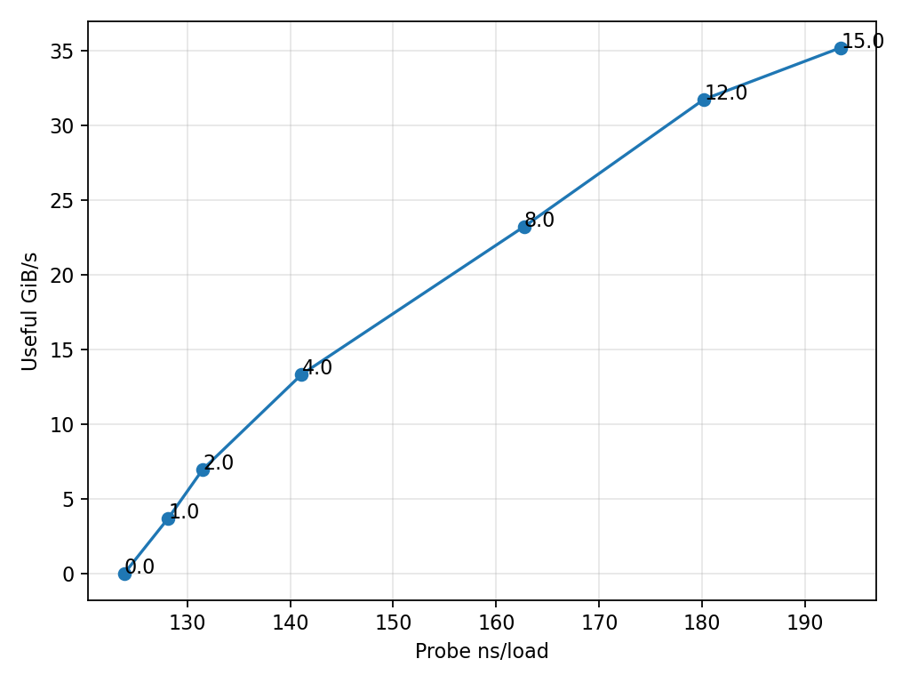
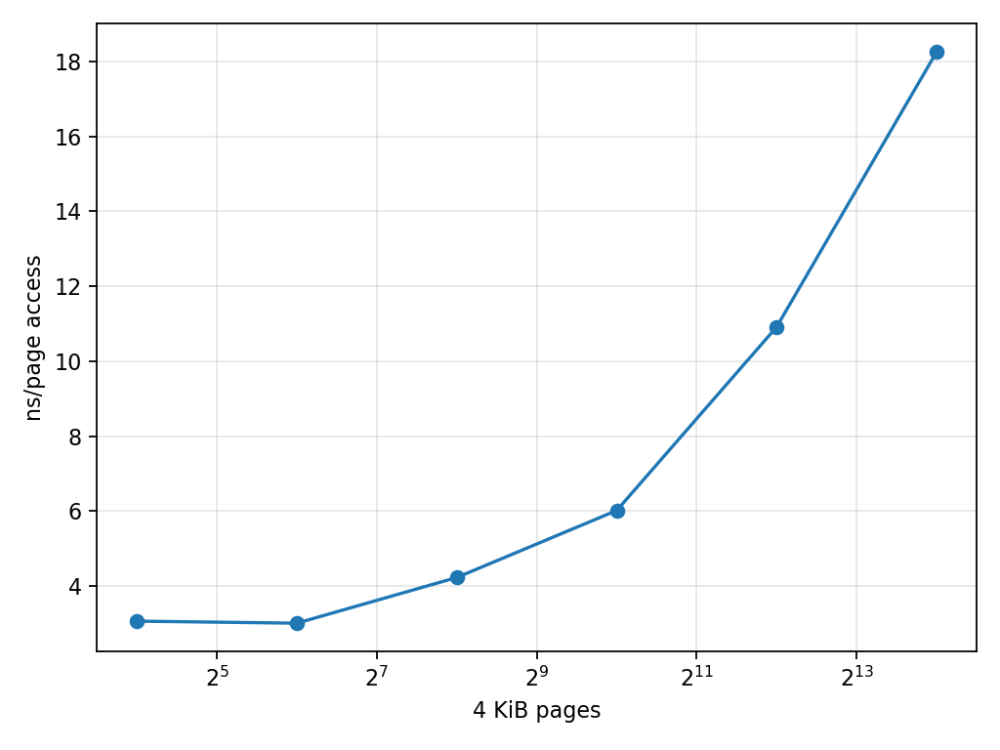

# Project 2 — Cache & Memory Performance Profiling

## Overview

This project implements a custom native MLC-equivalent using randomized dependent pointer chasing, sequential and randomized streaming, deterministic read/write mixes, loaded-latency workers, and normal-page TLB traversal. It characterizes hierarchy latency, locality, stride, concurrency, cache/TLB behavior, and supporting AMD uProf counters while retaining explicit measurement limitations.

## Key hierarchy results

| Region | Representative latency |
|---|---:|
| L1 | 1.262 ns/load |
| L2 | 3.328 ns/load |
| LLC | 11.973 ns/load |
| DRAM-sensitive | 111.876 ns/load |

## Key performance results

| Result | Measurement |
|---|---:|
| Sequential 64-byte read | 29.234 GiB/s |
| Random 64-byte read | 2.641 GiB/s |
| Sequential 64/256/1024 B strides | 29.234 / 11.566 / 10.331 GiB/s |
| Sequential 100/70/50/0% read mixes | 31.954 / 28.477 / 25.450 / 18.840 GiB/s |
| Maximum observed useful bandwidth | 36.347 GiB/s |
| Loaded worker throughput | 3.713 → 35.199 GiB/s |
| Dependent probe latency | 123.868 → 193.454 ns |
| TLB page-locality | ~3.0 ns at 16–64 pages → 18.257 ns at 16,384 pages |

The predefined loaded-latency knee remained unresolved within the tested safe intensity range. Useful bandwidth is not physical DRAM traffic.

[Final tables](results/tables/FINAL_TABLES.md) · [Reproduction guide](docs/reproduction.md) · [Final figure index](results/plots/FINAL_FIGURES.md)

### Representative figures

**Hierarchy latency**

**Throughput versus dependent-probe latency**

**Normal-page TLB behavior**

---

## 1. Objective

This ECSE 4320/6320 project characterizes how locality, pattern, stride, working set, concurrency, translation and read/write mix affect host-visible latency and useful bandwidth.

## 2. Pre-experiment hypotheses

Fifteen immutable hypotheses were committed before production measurements. [Originals](docs/hypotheses.md) and [outcomes](docs/hypothesis_outcomes.md).

## 3. Hardware/software environment

Windows 11 Enterprise build 26200; Ryzen 9 9950X; 16 physical/32 logical CPUs; 61.65 GiB OS-visible RAM; Clang 23.1.4 active build; Python 3.13.9; uProf 5.3.521.0. Balanced power, SMT, Hyper-V and VBS stayed unchanged. [Environment](docs/environment.md).

## 4. Cache and memory topology

AMD and Windows list aggregate L1/L2/L3 as 1,280 KiB/16 MiB/64 MiB. uProf exposes two cache domains. One Windows NUMA node exists. Aggregate cache is not assumed uniformly local to CPU 0.

## 5. Native MLC-equivalent benchmark

The C++20 suite implements randomized dependent pointer rings, sequential/random 64-byte operations, deterministic mixes, loaded latency and one-node-per-page TLB traversal. All measured work feeds a checksum or write validation.

## 6. Measurement methodology

Allocation/index generation occurs outside timing. QPC times pinned kernels; CPU 0 handles primary work. Three repetitions are standard and hierarchy baselines use five. Summary CSV reports median, mean, sample SD, CV, min and max. [Methodology](docs/methodology.md).

## 7. Correctness and timing validation

CTest, parser round trips, permutation bounds, exact mix counts, write checks, affinity, invalid-input rejection and QPC calibration passed. Phase 0 smoke data are labeled `NOT FOR PERFORMANCE ANALYSIS`.

## 8. L1/L2/LLC/DRAM latency

Representative dependent-load medians were 1.262 ns (16 KiB), 3.328 ns (512 KiB), 11.973 ns (16 MiB) and 111.876 ns (512 MiB). These approximate one outstanding request; labels are qualified. [Phase 1](docs/phase1_latency.md).

## 9. Sequential vs random behavior

At 1 GiB and 64-byte stride, median useful read bandwidth was 29.234 GiB/s sequential versus 2.641 GiB/s random—an 11.1× locality/prefetch advantage.

## 10. Stride/granularity effects

Sequential read medians fell 29.234→11.566→10.331 GiB/s for 64/256/1024 B strides; sequential writes fell 18.745→10.601→7.629. Random rates changed less because unpredictability already dominated. [Phase 2](docs/phase2_patterns.md).

## 11. Read/write behavior

Pure direction mattered: sequential read exceeded write at 64 B, while this kernel's randomized write rate exceeded its randomized read rate. Write allocate/writeback traffic is not measured.

## 12. Read/write mixes

Sequential 100/70/50/0% read medians were 31.954/28.477/25.450/18.840 GiB/s; random medians were 2.677/3.213/3.267/5.244. Schedules produced exact logical ratios.

## 13. Loaded latency and access intensity

Background useful throughput rose from 3.713 GiB/s at one worker to 35.199 at 15. Probe latency rose from 123.868 ns unloaded to 193.454 ns. Workers used distinct 128 MiB regions on physical-core representatives. [Phase 3](docs/phase3_loaded_latency.md).

## 14. Throughput-latency knee

The predefined rule required the next substantial worker step to add <10% bandwidth while adding >20% probe latency, confirmed by the following point. No step met both: **no clear knee resolved within the tested safe intensity range**.

## 15. Little's Law

`L=lambda W`, using useful background 64-byte ops/s and dependent-probe seconds/load, rose from 8.0 at one worker to 113.7 at 15. It is comparative host-visible concurrency—not a DRAM-controller queue count.

## 16. Working-set transitions

The dense sweep showed transition regions near 48–64 KiB, 512 KiB–2 MiB, and 16–32 MiB. Latency was 118.87 ns at 1 GiB. The 512 MiB non-monotonic point is retained. [Phase 4](docs/phase4_cache_tlb.md).

## 17. Cache-counter evidence

Four process profiles show L2 requests from L1D misses rising strongly beyond the 16 KiB case. Sampled totals include setup and differ in operations; no exact L3 miss rate is claimed. The maximum observed individual useful-bandwidth sample was 36.347 GiB/s at 512 KiB sequential read—cache-sensitive, not physical DRAM bandwidth.

## 18. TLB/page-locality behavior

One node per normal 4 KiB page measured ~3.0 ns at 16–64 pages, 4.22 ns at 256, 6.01 at 1,024, 10.91 at 4,096 and 18.26 at 16,384. Low/high uProf profiles provide supporting DTLB evidence.

## 19. Large-page limitation

Windows reports a 2 MiB minimum, but `SeLockMemoryPrivilege` is absent. Enabling it would violate the no-policy-change rule. The comparison is **UNAVAILABLE ON THIS TEST CONFIGURATION**.

## 20. Benchmark pitfall

The same kernel and 1 GiB useful work reported 35.262 GiB/s for a repeatedly reused 16 MiB span versus 31.369 for a 1 GiB span. The first is cache-reuse bandwidth, not DRAM bandwidth. [Pitfall](docs/phase5_pitfall.md).

## 21. AMAT-style interpretation

`AMAT = hit_time + miss_rate × miss_penalty` explains the qualitative growth as requests fall through more levels. Exact AMAT is not computed: level-specific hit probabilities, a direct L3 miss count and DRAM traffic are unavailable. uProf L1/L2 events support the interpretation but cannot fill those gaps.

## 22. Anomalies

GCC's compiler subprocess failed silently, so the authorized Clang fallback was used. Initial CTest runtime-path failure was corrected. The 512 MiB point and non-monotonic sampled counters remain visible. [Anomaly log](docs/anomalies.md).

## 23. Limitations

Balanced power, Hyper-V/VBS, SMT and background Windows activity add variation. There is one OS NUMA node; Windows cache totals are aggregate; uProf reports two domains and adds process overhead. No direct L3/DF/UMC/controller events exist. Useful bandwidth is not physical traffic. Large pages are unavailable. Size alone cannot prove residency, transitions may be gradual, and the 4.3 GHz field is not sustained measured frequency.

## 24. Reproducibility

Raw JSON, parsed CSV, portable uProf reports, configuration, code and generation scripts are versioned. Python is the active orchestration layer; no `.ps1` execution or system change is needed. [Reproduction guide](docs/reproduction.md).

## 25. Conclusions

The hierarchy ordering is clear; sequential locality and 64-byte stride dominate large-span bandwidth; concurrency raises both throughput and latency without resolving a safe-range knee; normal-page reach materially affects latency; and small-buffer reuse can overstate DRAM-sensitive performance.

## 26. AI-use statement

Codex assisted with implementation, automation, validation, plotting and drafting. Claims trace to retained measurements and reports, not invented hardware details. [Full disclosure](docs/ai_use.md).

Final indexes: [figures](results/plots/FINAL_FIGURES.md), [tables](results/tables/FINAL_TABLES.md), [requirement audit](docs/final_requirement_audit.md).
