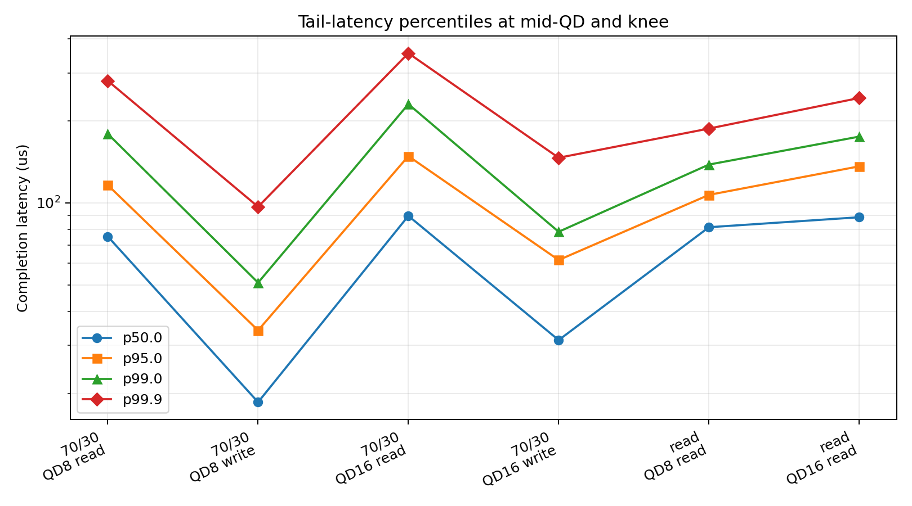
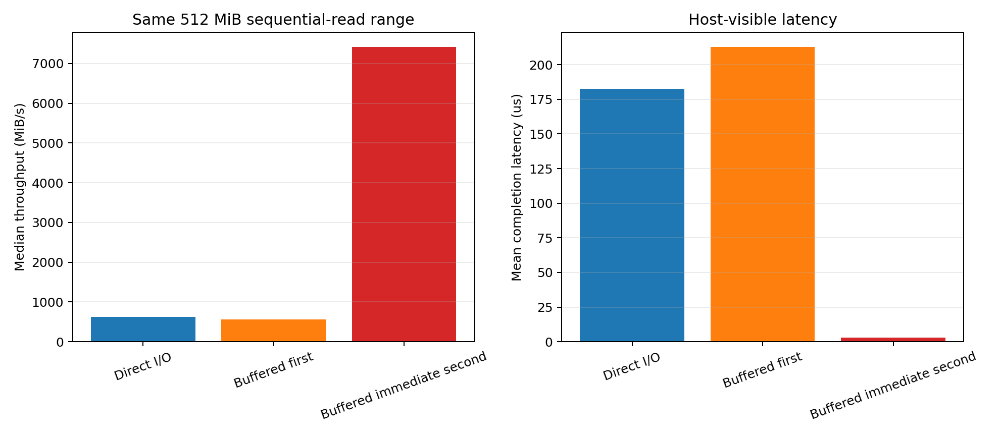
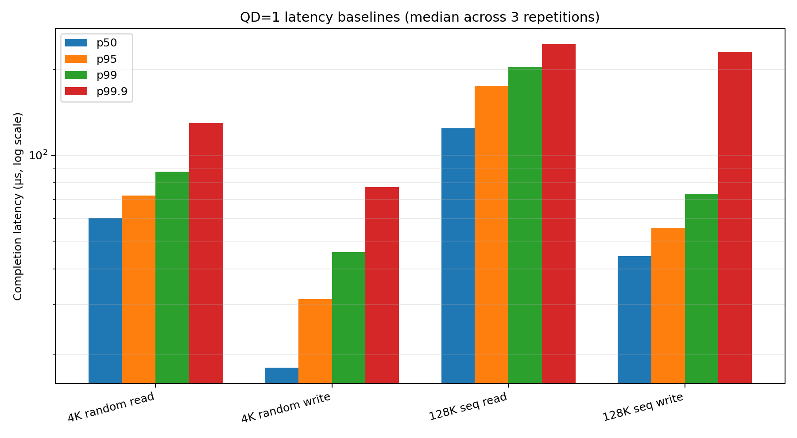
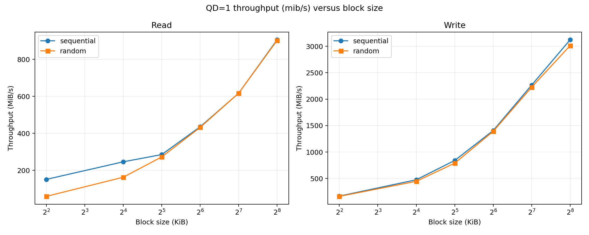
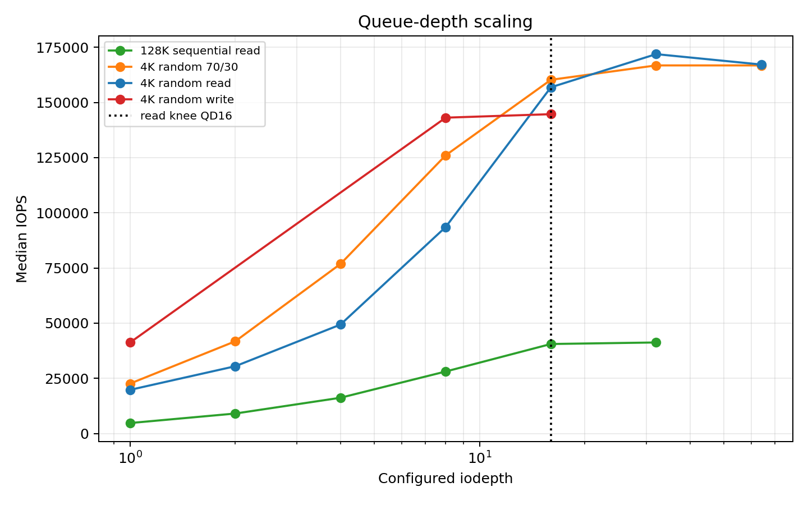

# Project 3 — SSD Performance Profiling

## Overview

This project uses official FIO 3.43 with `windowsaio`, `direct=1`, and a regular-file-only safety wrapper. It covers QD1 baselines, block-size and read/write-mix sweeps, queue-depth scaling, tail latency, Little's Law, working-set effects, a bounded device-state check, and a page-cache benchmark pitfall without targeting a raw disk, partition, or volume.

## QD1 results

| Workload | IOPS | Throughput | Mean clat |
|---|---:|---:|---:|
| 4 KiB random read | 15,769 | 61.6 MiB/s | 56.9 µs |
| 4 KiB random write | 37,681 | 147.2 MiB/s | 20.0 µs |
| 128 KiB sequential read | 7,162 | 895.2 MiB/s | 131.1 µs |
| 128 KiB sequential write | 17,384 | 2,172.9 MiB/s | 47.8 µs |

## Additional headline results

| Result | Measurement |
|---|---:|
| Maximum 4 KiB random-read IOPS | 171,868 at QD32 |
| Maximum 128 KiB sequential-read throughput | 5,158.6 MiB/s at QD32 |
| Numerical knee | QD16 |
| QD16 → QD32 | +9.6% IOPS; +49.2% mean latency |
| QD16 p50/p95/p99/p99.9 | 88.6 / 136.2 / 175.1 / 242.7 µs |
| Direct / first buffered / second buffered | 630.5 / 566.4 / 7,420.3 MiB/s |

The bounded device-state test completed too quickly to resolve a sustained cache, garbage-collection, or thermal transition.

[Final tables](results/tables/FINAL_TABLES.md) · [Reproduction guide](docs/reproduction.md) · [Requirement audit](docs/final_requirement_audit.md) · [Final figure index](results/plots/FINAL_FIGURES.md)

### Representative figures

**Queue-depth knee**

**Tail-latency percentiles**

**Buffered/direct page-cache pitfall**

---

## 1. Objective

This project profiles host-visible SSD performance across access pattern, block size, read/write mix, queue depth, tail latency, active range, device state, and one deliberately misleading buffered-I/O setup. Every measurement uses one disposable regular file; no raw disk, partition, or volume was targeted.

## 2. Safety strategy

The Python runner canonicalizes the target before every FIO invocation, permits only `benchmark_data/fio_production.bin`, sets the working directory to `benchmark_data`, passes only the basename to `--filename`, and verifies the reconstructed filename from actual FIO JSON afterward. It also enforces a 100 GiB free-space floor, an 80 GiB logical-write budget, immutable raw outputs, and `direct=0` only for Phase 7. The production file is ignored by Git.

## 3. Pre-experiment hypotheses

The twelve unchanged hypotheses are in [docs/hypotheses.md](docs/hypotheses.md); their measured outcomes are in [docs/hypothesis_outcomes.md](docs/hypothesis_outcomes.md).

## 4. Hardware/software environment

The system SSD is a KIOXIA KXG80ZNV1T02 REV2 (APGA4102), NVMe, 953.87 GiB usable, on Windows 11 Enterprise. Measurements used official FIO 3.43 at `C:\Program Files\fio\fio.exe`, `windowsaio`, and the existing Anaconda Python 3.13.9 stack. See [docs/environment.md](docs/environment.md).

## 5. Experimental methodology

Primary runs use `direct=1`, one 8 GiB initialized regular file, FIO JSON, explicit percentile collection, and three independent repetitions per ordinary configuration. Read jobs use bounded time windows; write-capable jobs use bounded logical I/O. Canonical raw JSON lives under `data/raw`; regenerated run/summary CSVs live under `data/parsed`. The Phase 0/1 smoke artifacts are excluded from performance analysis.

## 6. QD=1 baselines

| Workload | Median IOPS | Median MiB/s | Mean clat us | p99 us |
|---|---:|---:|---:|---:|
| randread_4k_qd1 | 15,769 | 61.6 | 56.9 | 87.6 |
| randwrite_4k_qd1 | 37,681 | 147.2 | 20.0 | 45.8 |
| seqread_128k_qd1 | 7,162 | 895.2 | 131.1 | 203.8 |
| seqwrite_128k_qd1 | 17,384 | 2,172.9 | 47.8 | 73.2 |

The identity `IOPS x block size ~= throughput` passed within 0.2% for every baseline run. See [QD1 table](results/tables/qd1_baseline.md) and [analysis](docs/phase2_qd1_analysis.md).

## 7. Block-size effects

At fixed QD1, small blocks emphasized IOPS while larger transfers raised bandwidth and completion latency. The highest matrix median was 43,003 IOPS for sequential write at 4k; the highest matrix throughput was 3,122.0 MiB/s for sequential write at 256k. These are QD1 results, not device maxima.

## 8. Random vs sequential access

The full 24-configuration Phase 3 matrix separates random/sequential and read/write behavior across 4, 16, 32, 64, 128, and 256 KiB. Sequential large-block access reached much higher bandwidth than 4 KiB random access, supporting the pre-experiment pattern hypothesis within this host stack.

## 9. Read vs write behavior

Read and write endpoints differed substantially. At QD1, 4 KiB random write measured 37,681 IOPS versus 15,769 for random read; 128 KiB sequential write measured 2,172.9 MiB/s versus 895.2 for read. These are observed results, not evidence of a specific controller or NAND mechanism.

## 10. Read/write mixes

| Read/write | Median IOPS | Median MiB/s | Weighted mean clat us |
|---|---:|---:|---:|
| 100/0 | 89,340 | 349.0 | 79.7 |
| 70/30 | 124,004 | 484.4 | 52.3 |
| 50/50 | 126,274 | 493.3 | 48.4 |
| 0/100 | 147,770 | 577.2 | 32.9 |

The mixed points were not a simple linear interpolation of pure endpoints, and direction-specific tail distributions differed. See [Phase 4 analysis](docs/phase4_mix_analysis.md).

## 11. Queue-depth scaling

4 KiB random-read IOPS rose from 19,801 at QD1 to 156,847 at QD16 and peaked at 171,868 at QD32. QD64 was lower and much slower in latency, so QD128/256 were not scientifically justified.

## 12. Throughput-latency knee

The predeclared numerical rule selects the earliest QD whose next doubling adds less than 10% median IOPS while raising mean completion latency by at least 20%. It identifies QD16: QD16 to QD32 added 9.6% IOPS while latency rose 49.2%.

## 13. Little's Law

At QD16, `L_inferred = IOPS x mean_clat` was 13.40, versus configured `iodepth=16`; at QD32 it was 21.90. The trend is queueing-consistent, but configured submission depth and inferred average occupancy are not identical because of host scheduling, batching, and latency accounting boundaries.

## 14. Tail latency

For 4 KiB random read at QD8, p50/p95/p99/p99.9 were 81.4/107.0/138.2/187.4 us. At the QD16 knee they were 88.6/136.2/175.1/242.7 us. Millions of completed read I/Os make p99.9 interpretable with thousands of tail observations.

## 15. Working-set / LBA-range

At fixed 4 KiB random read QD16, the 256 MiB range produced 143,114 median IOPS and the 8 GiB range 141,571; p99 was 171.0 versus 173.1 us. The small difference is host-visible and does not identify a physical NAND boundary.

## 16. Burst vs sustained/device-state behavior

One safe 8 GiB direct sequential-write pass at 1 MiB/QD8 completed at 5,142.5 MiB/s in 1.59 s. The 1-second logger produced only one interval, so early/middle/late behavior is unresolved. No clear burst-to-steady-state transition was observed within the safe 8 GiB test window, and temperature telemetry was unavailable.

## 17. Benchmark pitfalls

The immediate second buffered pass reached 7,420.3 MiB/s, versus 566.4 MiB/s for the first buffered pass and 630.5 MiB/s for direct I/O. This demonstrates host page-cache contamination. Other pitfalls include Windows FIO colon parsing for absolute paths, QD/occupancy confusion, short bursts, sparse tail samples, device-state uncertainty, and noise.

## 18. Anomalies

The Phase 0 absolute-path smoke attempt exposed FIO's Windows colon parsing and created an unintended regular file named `C`; it was safely audited, explicitly authorized for deletion, and its invalid artifacts remain excluded. Phase 4 analysis initially rejected empty inactive-direction percentile fields; the parser was corrected to preserve them as missing, and no FIO run was repeated. The device-state log contained only one interval due to the short completion time.

## 19. Limitations

This is a regular-file study on the boot/system SSD through the Windows storage stack, not raw-device testing. No device-internal temperature, wear, NAND, garbage-collection, or SLC telemetry was available. Logical FIO writes are not physical NAND writes. Direct I/O reduces page-cache effects but does not expose all internal caching. Short safe state testing may not reach steady state, and extreme percentiles remain sample-count dependent.

## 20. Reproducibility

See [docs/reproduction.md](docs/reproduction.md), [final requirement audit](docs/final_requirement_audit.md), [final figures](results/plots/FINAL_FIGURES.md), and [final tables](results/tables/FINAL_TABLES.md). Python is the supported executable workflow because `.ps1` execution is restricted; no PowerShell policy change is required.

## 21. Conclusions

The tested stack transitions from QD-limited scaling to a QD16 knee, reaches 171,868 median 4 KiB IOPS and 5,158.6 MiB/s median 128 KiB sequential-read throughput within the measured matrix, and shows sharply rising tails with concurrency. Block size, access pattern, direction, and mix all materially affect results. Buffered repeat reads can overstate apparent storage throughput by an order of magnitude.

## 22. AI-use statement

Codex assisted with safety scripting, FIO configuration, automation, plotting, statistics, and analysis drafting; generated outputs were independently tested against target-safety checks, retained FIO JSON, repeated measurements, and parser/tool evidence. AI did not independently verify internal SSD behavior. See [docs/ai_use.md](docs/ai_use.md) for the full disclosure.
